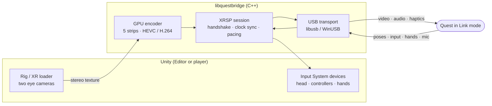

# QuestBridge

**An open-source implementation of Meta's Quest Link protocol. Press Play in Unity, and your scene runs on a Quest over USB.**

QuestBridge speaks the wired Link protocol (XRSP over USB) itself, written from scratch. The headset's built-in Link mode does the rest: there's nothing to install on the Quest. It isn't tied to one platform; today it runs on **Windows** and **macOS (Apple silicon)**.

[](https://github.com/ElasticSea/questbridge/actions/workflows/ci.yml)
[](LICENSE)


## Status

| | Windows 10/11 | macOS (Apple silicon) |
|---|---|---|
| Unity Editor Play mode | ✅ | 🚧 the headset ends the stream after ~1 s ([roadmap](docs/roadmap.md)) |
| Standalone player builds | ✅ | 🧪 builds and loads the plugin |
| Video at 72 Hz | ✅ H.264, Media Foundation (OpenH264 fallback) | ✅ HEVC or H.264, VideoToolbox |
| Head tracking with timewarp | ✅ | 🧪 |
| Controllers: poses, buttons, sticks, haptics | ✅ | 🧪 |
| Hand tracking (26 joints, Unity XR Hands) | ✅ | 🧪 |
| Game audio to the headset, headset mic to Unity | ✅ | 🧪 |
| Connect without replugging, recover after the headset sleeps | ✅ | 🧪 |
| XR Plug-in Management loader (unchanged XR Origin / XRI projects) | 🧪 | 🧪 |

✅ verified on a headset · 🧪 implemented and covered by tests, not yet verified on a headset · 🚧 known problem

**Headsets:** verified on Quest 3 (Windows) and Quest Pro (macOS video). Quest 3S and Quest 2 speak the same protocol but haven't been tried.

## Quick start

1. **Headset:** Settings → System → Quest Link → turn **Quest Link** on. Plug it in with a USB-C data cable.
2. **Unity 6000.3:** Window → Package Manager → **+** → *Add package from git URL*:
   ```
   https://github.com/ElasticSea/questbridge.git?path=/unity/com.elasticsea.questbridge#v0.2.0
   ```
3. **GameObject → XR → QuestBridge Rig**, press **Play**, put the headset on and press **Launch**.

Already have an XR Origin scene? Tick **QuestBridge** in Project Settings → XR Plug-in Management instead of step 3.

**QuestBridge → Check Setup** tells you what's missing on your machine. The full walkthrough is in [Getting started](docs/getting-started.md).

> **Windows:** install Meta's Quest Link app once for its USB driver. While you play, QuestBridge pauses Meta's Link service (one admin prompt per Unity session) and starts it again when Unity quits.

## How it works



Unity renders both eyes into one texture. The native library encodes it on the GPU in five horizontal strips, wraps them in Link's video messages and sends them over USB, timed to the headset's display. Poses, buttons, hand joints and microphone audio flow back the same way. More detail is in [Architecture](docs/architecture.md), and the protocol itself is documented in the [protocol spec](docs/protocol/spec.md).

## Repository layout

| Path | What's there |
|---|---|
| [`unity/com.elasticsea.questbridge`](unity/com.elasticsea.questbridge) | The Unity package: rig, XR loader, Input System devices, XR Hands provider, audio |
| [`native/`](native) | `libquestbridge`: USB, protocol, encoders, C API, the `qbhost` CLI and C++ tests |
| [`tools/`](tools) | Python protocol toolkit: capture decoders, fixture extraction, test runners |
| [`tests/`](tests) | Protocol tests against recorded, anonymized sessions (shared with the C++ tests) |
| [`docs/`](docs) | Guides, architecture and the protocol spec |

## Limitations

- 72 Hz only; 90/120 Hz modes aren't implemented yet.
- No passthrough or environment depth over the link yet.
- macOS: Editor Play mode doesn't stream yet (see the [roadmap](docs/roadmap.md)); the prebuilt library needs Apple silicon and macOS 26.
- Windows needs a GPU with a hardware H.264 encoder; OpenH264 is a slower fallback.
- One headset per machine.

See the [roadmap](docs/roadmap.md) for what's next.

## Building and testing

```bash
python3 -m unittest discover -s tests          # protocol tests, no headset needed
cmake -S native -B native/build -DCMAKE_BUILD_TYPE=Release
cmake --build native/build --config Release
ctest --test-dir native/build -C Release --output-on-failure
```

Prerequisites, the Unity test suites and how to rebuild the prebuilt plugins are covered in [Building](docs/building.md) and [Testing](docs/testing.md).

## Contributing

Bug reports, captures of odd behavior and pull requests are welcome. Please read [CONTRIBUTING.md](CONTRIBUTING.md) first. In particular, contributions must be your own work, not code copied from other Link implementations or from Meta's software.

## Legal

QuestBridge is an independent interoperability project. It contains no code from Meta and is **not affiliated with, endorsed or sponsored by Meta Platforms, Inc.** Meta, Meta Quest, Quest and Quest Link are trademarks of Meta Platforms, Inc., used here only to describe compatibility. See [NOTICE](NOTICE).

Licensed under the [Apache License 2.0](LICENSE).
