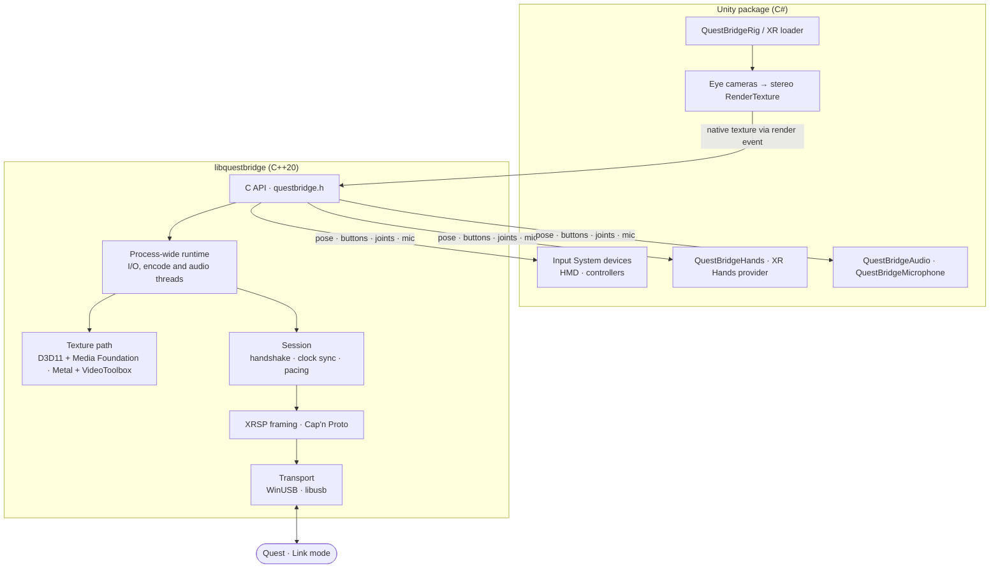

# Architecture

## Unity package

`unity/com.elasticsea.questbridge` has two ways in:

- **Rig** (`QuestBridgeRig`, prefab *QuestBridge Rig*): creates two eye cameras under a `Head` transform, renders them into one side-by-side texture with off-axis projections built from the headset's per-eye field of view, and submits it once per frame with the exact head pose it rendered from.
- **XR loader** (`QuestBridgeLoader`, XR Plug-in Management): for unchanged XR Origin / XR Interaction Toolkit projects. It adds the eye cameras under `Camera.main` and feeds the same Input System devices.

Head, controllers and haptics appear as standard Input System `XRHMD` / `XRController` devices, so `TrackedPoseDriver`, XRI and generic XR bindings work unchanged. Hands come through `QuestBridgeHands` and, with Unity XR Hands installed, an `XRHandSubsystem`. Without the native library (or in tests) a mock backend animates the head, controllers and hands.

## Native library

`native/` builds `libquestbridge` (`questbridge.dll` on Windows) with a C API in `include/questbridge.h`:

- **Session API** (`qb_open`, `qb_get_head_pose`, `qb_submit_frame_texture`, `qb_get_hands`, `qb_haptic`, `qb_submit_audio`, …) for Unity. One process-wide runtime owns USB and the headset session and outlives Unity's Play sessions, so Stop and Play doesn't reconnect.
- **Host API** (`qb_host_*`): one connection driven by the caller, used by `qbhost` and the tests.

Inside, `src/` holds the protocol core with no I/O (XRSP framing, the schema-less Cap'n Proto codec, handshake and clock sync, video frame building, pose, hand, controller and audio parsing), the USB transports, and the texture paths:

- **Windows:** the D3D11 texture is split into strips and encoded by a Media Foundation hardware encoder chosen per GPU vendor, with OpenH264 as the software fallback.
- **macOS:** Metal render passes split the texture into five IOSurface-backed strips that go straight to five VideoToolbox HEVC sessions, with no CPU copy.

The headset decodes the picture as five independent 4096×448 strips, which is why every encoder path produces strips (or slices with the same layout). Every compressed slice must fit in one XRSP message, so the encoders re-encode an oversized slice at a higher quantizer rather than drop it.

## Recovery

The runtime keeps a running app streaming through disconnects. After a short USB glitch it resumes the same stream. After the USB device disappears (Link quit, cable, headset reboot), a goodbye from the headset, or 3 s of silence, it reopens and runs a new handshake; the wearer presses Launch again. `QuestBridgeConnectionStatus` reports each state change in Unity. [Connecting](protocol/connecting.md) has the full table.

## Python toolkit

`tools/` is the protocol research side: a USBPcap reader, the XRSP splitter, a schema-less Cap'n Proto codec, decoders per stream (video, pose, hands, controllers, audio), fixture extraction with identifier scrubbing, and the generator for the native message templates. `tests/` checks it byte-exact against recorded sessions; the C++ tests reuse the same fixtures.
